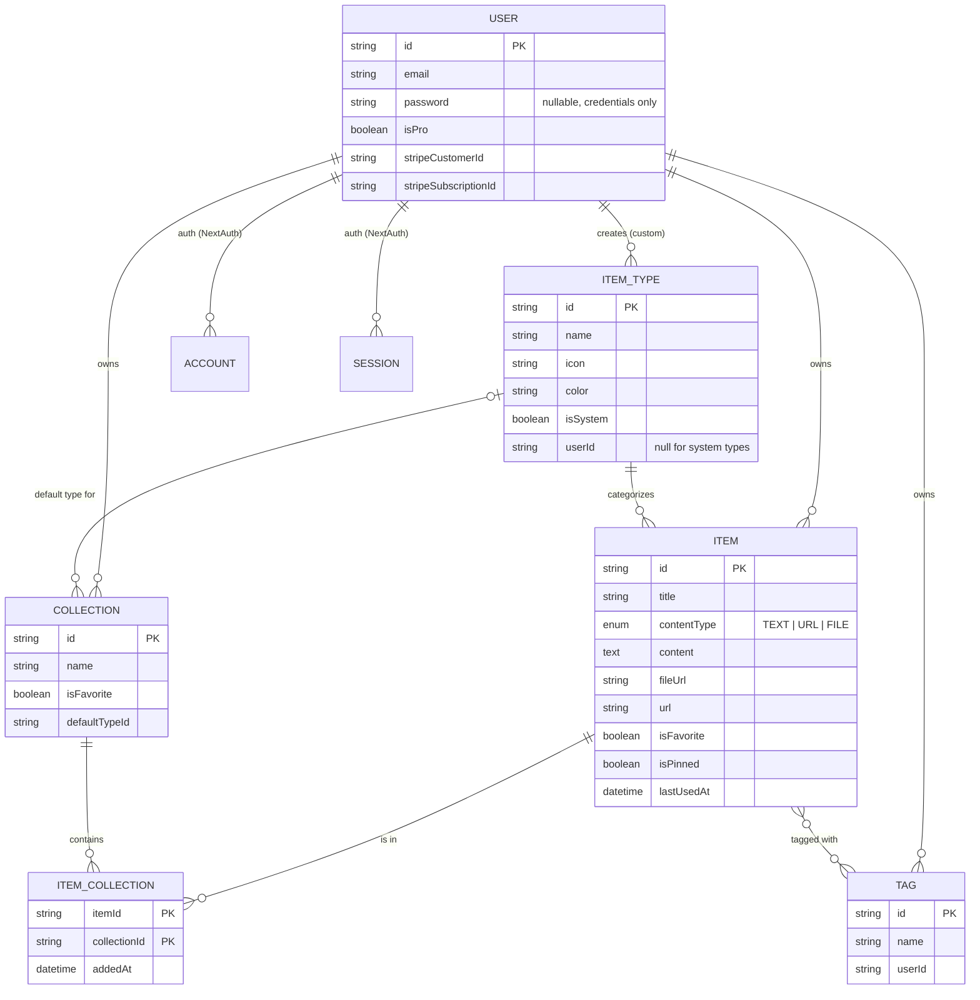
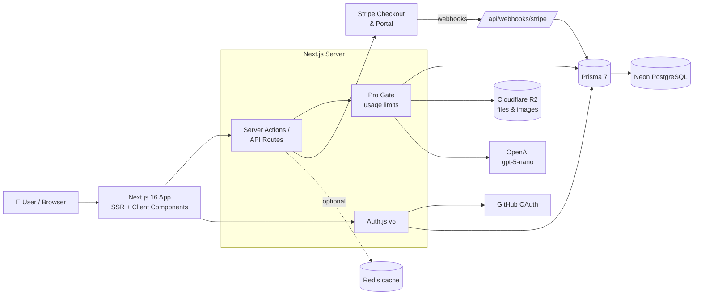

# 🗃️ DevStash: Project Overview

> **One fast, searchable, AI-enhanced hub for all your dev knowledge and resources.**

DevStash is a freemium SaaS that gives developers a single home for snippets, prompts, commands, notes, links, files and images, organized into collections and findable in seconds.

---

## 📑 Table of Contents

1. [Problem](#-problem)
2. [Target Users](#-target-users)
3. [Features](#-features)
4. [Data Model](#-data-model)
5. [Prisma Schema](#-prisma-schema-draft)
6. [Tech Stack](#-tech-stack)
7. [Architecture](#-architecture)
8. [Routes](#-routes)
9. [Monetization](#-monetization)
10. [UI / UX](#-ui--ux)
11. [Environment Variables](#-environment-variables)
12. [Open Questions & Review Notes](#-open-questions--review-notes)
13. [Reference Links](#-reference-links)

---

## 🧩 Problem

Developers keep their essentials scattered across many tools:

| Resource | Where it usually lives |
| --- | --- |
| Code snippets | VS Code, Notion |
| AI prompts | Old chat threads |
| Context files | Buried in project folders |
| Useful links | Browser bookmarks |
| Docs | Random folders |
| Commands | `.txt` files |
| Project templates | GitHub Gists |
| Terminal commands | Bash history |

This causes **context switching**, **lost knowledge** and **inconsistent workflows**.

**DevStash's answer:** one fast, searchable, AI-enhanced hub for all of it.

---

## 👥 Target Users

| Persona | Needs |
| --- | --- |
| 🧑‍💻 **Everyday Developer** | A fast way to grab snippets, prompts, commands and links |
| 🤖 **AI-first Developer** | A home for prompts, context files, workflows and system messages |
| 🎓 **Content Creator / Educator** | Storage for code blocks, explanations and course notes |
| 🏗️ **Full-stack Builder** | A library of patterns, boilerplates and API examples |

---

## ✨ Features

### A. Items & Item Types

Every item has a **type**. DevStash ships with seven **system types**, which cannot be edited or deleted. **Custom types** are a Pro feature planned for a later phase.

| Type | Content kind | Icon (Lucide) | Color | Plan |
| --- | --- | --- | --- | --- |
| Snippet | `TEXT` | `Code` |  `#3b82f6` | Free |
| Prompt | `TEXT` | `Sparkles` |  `#8b5cf6` | Free |
| Command | `TEXT` | `Terminal` |  `#f97316` | Free |
| Note | `TEXT` | `StickyNote` |  `#fde047` | Free |
| Link | `URL` | `Link` |  `#10b981` | Free |
| File | `FILE` | `File` |  `#6b7280` | Pro |
| Image | `FILE` | `Image` |  `#ec4899` | Pro |

- Each type has a list page at a pluralized slug, e.g. `/items/snippets`, `/items/prompts`.
- Items open and are created in a **quick-access drawer**, so the user never leaves the current page.

### B. Collections

- Users create collections that can hold items of **any type**.
- An item can belong to **multiple collections** (e.g. a React snippet in both *React Patterns* and *Interview Prep*).
- An item's detail view shows **which collections it belongs to**, and items can be added to or removed from several collections at once.

Example collections:

| Collection | Typical contents |
| --- | --- |
| React Patterns | Snippets, notes |
| Context Files | Files |
| Python Snippets | Snippets |

### C. Search

Search across **titles**, **content**, **tags** and **types**.

- **Free:** basic search (title, tags, type filter).
- **Pro:** full search including content (Postgres full-text search to start; revisit if needed).

### D. Authentication

- Email + password (Credentials provider, hashed passwords)
- GitHub OAuth

### E. Core Features

- ⭐ Favorite collections and items
- 📌 Pin items to the top
- 🕘 Recently used items
- 📥 Import code from a file
- 📝 Markdown editor for text types
- 🖍️ Syntax highlighting for code
- ⬆️ File upload for File/Image types (Cloudflare R2)
- 📤 Export data (JSON / ZIP)
- 🌙 Dark mode by default, light mode optional

### F. AI Features (Pro)

Powered by OpenAI `gpt-5-nano`.

| Feature | What it does |
| --- | --- |
| 🏷️ Auto-tag suggestions | Suggests tags based on item content |
| 📄 Summaries | Generates a short description for an item |
| 💡 Explain This Code | Plain-language explanation of a snippet |
| ⚡ Prompt Optimizer | Rewrites a prompt to be clearer and more effective |

---

## 🗄️ Data Model

> This is a working draft, not set in stone.



### Key decisions

- **`contentType` is an enum with three values** (`TEXT`, `URL`, `FILE`), matching the three kinds of type described in the features. The original notes only had `text | file`, which left links without a kind.
- **Tags are per-user** (`@@unique([userId, name])`), so one user's tags never show up for another.
- **Items ↔ Tags** is a simple many-to-many (Prisma implicit join table). **Items ↔ Collections** uses an explicit join table so `addedAt` can be stored.
- **`lastUsedAt`** was added to `Item` to power the *Recently used* feature.
- **System types** have `userId = null` and `isSystem = true`; they are created by a seed script.
- Deleting a user, item or collection **cascades** to its join rows. Deleting an item type that still has items is **blocked**.

---

## 🧬 Prisma Schema (Draft)

> ⚠️ **Never use `prisma db push`** or edit the database directly. All schema changes go through migrations: `prisma migrate dev` locally, then `prisma migrate deploy` in production.

Prisma 7 moves the connection URL out of `schema.prisma` and into `prisma.config.ts`, uses the new `prisma-client` generator with an explicit output path, and connects through a driver adapter (the Neon adapter here). Check the exact syntax against the current docs before running anything.

### `prisma.config.ts`

```ts
import "dotenv/config";
import { defineConfig, env } from "prisma/config";

export default defineConfig({
  schema: "prisma/schema.prisma",
  migrations: {
    path: "prisma/migrations",
    seed: "tsx prisma/seed.ts",
  },
  datasource: {
    url: env("DATABASE_URL"),
  },
});
```

### `prisma/schema.prisma`

```prisma
generator client {
  provider = "prisma-client"
  output   = "../src/generated/prisma"
}

datasource db {
  provider = "postgresql"
}

// ─────────────────────────────────────────────
// Enums
// ─────────────────────────────────────────────

enum ContentType {
  TEXT
  URL
  FILE
}

// ─────────────────────────────────────────────
// Auth (NextAuth / Auth.js v5 Prisma adapter)
// ─────────────────────────────────────────────

model User {
  id            String    @id @default(cuid())
  name          String?
  email         String?   @unique
  emailVerified DateTime?
  image         String?
  password      String?   // bcrypt/argon2 hash, credentials users only

  // Billing
  isPro                Boolean @default(false)
  stripeCustomerId     String? @unique
  stripeSubscriptionId String? @unique

  accounts    Account[]
  sessions    Session[]
  items       Item[]
  itemTypes   ItemType[]
  collections Collection[]
  tags        Tag[]

  createdAt DateTime @default(now())
  updatedAt DateTime @updatedAt
}

model Account {
  userId            String
  type              String
  provider          String
  providerAccountId String
  refresh_token     String?
  access_token      String?
  expires_at        Int?
  token_type        String?
  scope             String?
  id_token          String?
  session_state     String?

  user User @relation(fields: [userId], references: [id], onDelete: Cascade)

  createdAt DateTime @default(now())
  updatedAt DateTime @updatedAt

  @@id([provider, providerAccountId])
}

model Session {
  sessionToken String   @unique
  userId       String
  expires      DateTime

  user User @relation(fields: [userId], references: [id], onDelete: Cascade)

  createdAt DateTime @default(now())
  updatedAt DateTime @updatedAt
}

model VerificationToken {
  identifier String
  token      String
  expires    DateTime

  @@id([identifier, token])
}

// ─────────────────────────────────────────────
// Core domain
// ─────────────────────────────────────────────

model ItemType {
  id       String  @id @default(cuid())
  name     String  // "Snippet"
  slug     String  // "snippets" → /items/snippets
  icon     String  // Lucide icon name, e.g. "Code"
  color    String  // hex, e.g. "#3b82f6"
  isSystem Boolean @default(false)

  userId String? // null for system types
  user   User?   @relation(fields: [userId], references: [id], onDelete: Cascade)

  items              Item[]
  defaultCollections Collection[]

  @@unique([userId, slug])
}

model Item {
  id          String      @id @default(cuid())
  title       String
  description String?
  contentType ContentType

  // TEXT
  content  String? @db.Text
  language String? // e.g. "typescript", for syntax highlighting

  // URL
  url String?

  // FILE
  fileUrl  String? // R2 object URL/key
  fileName String?
  fileSize Int?    // bytes

  isFavorite Boolean   @default(false)
  isPinned   Boolean   @default(false)
  lastUsedAt DateTime?

  userId String
  user   User   @relation(fields: [userId], references: [id], onDelete: Cascade)

  itemTypeId String
  itemType   ItemType @relation(fields: [itemTypeId], references: [id], onDelete: Restrict)

  tags        Tag[]
  collections ItemCollection[]

  createdAt DateTime @default(now())
  updatedAt DateTime @updatedAt

  @@index([userId, itemTypeId])
  @@index([userId, isPinned])
  @@index([userId, lastUsedAt])
}

model Collection {
  id          String  @id @default(cuid())
  name        String
  description String?
  isFavorite  Boolean @default(false)

  defaultTypeId String?
  defaultType   ItemType? @relation(fields: [defaultTypeId], references: [id], onDelete: SetNull)

  userId String
  user   User   @relation(fields: [userId], references: [id], onDelete: Cascade)

  items ItemCollection[]

  createdAt DateTime @default(now())
  updatedAt DateTime @updatedAt

  @@index([userId])
}

model ItemCollection {
  itemId       String
  collectionId String
  addedAt      DateTime @default(now())

  item       Item       @relation(fields: [itemId], references: [id], onDelete: Cascade)
  collection Collection @relation(fields: [collectionId], references: [id], onDelete: Cascade)

  @@id([itemId, collectionId])
  @@index([collectionId])
}

model Tag {
  id   String @id @default(cuid())
  name String

  userId String
  user   User   @relation(fields: [userId], references: [id], onDelete: Cascade)

  items Item[]

  @@unique([userId, name])
}
```

### Prisma client (Neon adapter)

```ts
// src/lib/db.ts
import { PrismaClient } from "@/generated/prisma/client";
import { PrismaNeon } from "@prisma/adapter-neon";

const adapter = new PrismaNeon({ connectionString: process.env.DATABASE_URL! });

const globalForPrisma = globalThis as unknown as { prisma?: PrismaClient };

export const prisma = globalForPrisma.prisma ?? new PrismaClient({ adapter });

if (process.env.NODE_ENV !== "production") globalForPrisma.prisma = prisma;
```

### Seed: system types

```ts
// prisma/seed.ts (excerpt)
const systemTypes = [
  { name: "Snippet", slug: "snippets", icon: "Code",       color: "#3b82f6" },
  { name: "Prompt",  slug: "prompts",  icon: "Sparkles",   color: "#8b5cf6" },
  { name: "Command", slug: "commands", icon: "Terminal",   color: "#f97316" },
  { name: "Note",    slug: "notes",    icon: "StickyNote", color: "#fde047" },
  { name: "File",    slug: "files",    icon: "File",       color: "#6b7280" },
  { name: "Image",   slug: "images",   icon: "Image",      color: "#ec4899" },
  { name: "Link",    slug: "links",    icon: "Link",       color: "#10b981" },
];
```

> Postgres treats `NULL`s as distinct in unique constraints, so `@@unique([userId, slug])` will **not** stop duplicate system types. Make the seed idempotent (look up by `slug` where `isSystem = true` before creating).

---

## 🛠️ Tech Stack

| Layer | Choice | Notes |
| --- | --- | --- |
| Framework | **Next.js 16** + **React 19** | SSR pages with dynamic client components; API routes / server actions for the backend |
| Language | **TypeScript** | End-to-end type safety |
| Database | **Neon** (serverless PostgreSQL) | Separate branches for dev and prod |
| ORM | **Prisma 7** | Migrations only, never `db push` |
| Cache | **Redis** *(maybe)* | Defer until there is a measured need |
| File storage | **Cloudflare R2** | S3-compatible; use presigned URLs for uploads |
| Auth | **NextAuth (Auth.js) v5** | Credentials + GitHub OAuth |
| AI | **OpenAI `gpt-5-nano`** | Pro-only features |
| Payments | **Stripe** | Subscriptions, Checkout, Customer Portal, webhooks |
| Styling | **Tailwind CSS v4** + **shadcn/ui** | Dark theme by default |
| Icons | **Lucide** | Ships with shadcn/ui |
| Repo | Single codebase | Less overhead |

---

## 🏛️ Architecture



### Suggested project structure

```
devstash/
├── prisma/
│   ├── schema.prisma
│   ├── migrations/
│   └── seed.ts
├── prisma.config.ts
├── src/
│   ├── app/
│   │   ├── (auth)/              # sign-in, sign-up
│   │   ├── (dashboard)/         # sidebar layout
│   │   │   ├── page.tsx         # collections grid
│   │   │   ├── items/[type]/    # /items/snippets etc.
│   │   │   ├── collections/[id]/
│   │   │   └── settings/
│   │   └── api/
│   │       ├── auth/[...nextauth]/
│   │       ├── upload/          # R2 presigned URLs
│   │       ├── ai/              # tag, summarize, explain, optimize
│   │       └── webhooks/stripe/
│   ├── components/
│   │   ├── ui/                  # shadcn/ui
│   │   ├── items/               # ItemCard, ItemDrawer, editors
│   │   ├── collections/
│   │   └── layout/              # Sidebar, MobileDrawer
│   ├── lib/
│   │   ├── db.ts
│   │   ├── auth.ts
│   │   ├── r2.ts
│   │   ├── openai.ts
│   │   ├── stripe.ts
│   │   └── limits.ts            # free vs pro checks
│   └── generated/prisma/        # Prisma client output (git-ignored)
└── .env
```

---

## 🧭 Routes

| Route | Purpose |
| --- | --- |
| `/` | Dashboard: grid of collection cards |
| `/items/[type]` | All items of a type, e.g. `/items/snippets` |
| `/collections/[id]` | Items in one collection |
| `/favorites` | Favorite items and collections |
| `/search?q=` | Search results |
| `/settings` | Profile, theme, export, billing |
| `/sign-in`, `/sign-up` | Authentication |

Items open in a **drawer** over the current page. Consider giving the drawer a shareable URL (e.g. `?item=<id>`) so deep links work.

---

## 💳 Monetization

Freemium model.

| | 🆓 Free | 🚀 Pro |
| --- | --- | --- |
| **Price** | $0 | **$8 / month** or **$72 / year** (25% off) |
| Items | 50 total | Unlimited |
| Collections | 3 | Unlimited |
| System types | All except File & Image | All |
| File & image uploads | ❌ | ✅ |
| Custom types | ❌ | ✅ *(later phase)* |
| Search | Basic | Full (incl. content) |
| AI auto-tagging | ❌ | ✅ |
| AI summaries | ❌ | ✅ |
| AI code explanation | ❌ | ✅ |
| AI prompt optimizer | ❌ | ✅ |
| Export (JSON / ZIP) | ❌ | ✅ |
| Priority support | ❌ | ✅ |

> 🧪 **During development:** build the full Pro foundation (`isPro`, Stripe fields, limit checks in `lib/limits.ts`), but let **all users access everything**, e.g. via a `FEATURE_GATING_ENABLED=false` env flag.

### Implementation notes

- Enforce limits **on the server** (server actions/API routes), not just in the UI.
- Keep `isPro` in sync through Stripe webhooks: `checkout.session.completed`, `customer.subscription.updated`, `customer.subscription.deleted`.
- Decide what happens on downgrade when a user is over the free limits (suggestion: keep data read-only, block new creation).

---

## 🎨 UI / UX

### General

- Modern, minimal, developer-focused
- **Dark mode by default**, light mode optional
- Clean typography, generous whitespace
- Subtle borders and shadows
- Syntax highlighting for code blocks
- Inspiration: [Notion](https://www.notion.so), [Linear](https://linear.app), [Raycast](https://www.raycast.com)

### Layout

```
┌───────────────┬──────────────────────────────────────────────┐
│  DevStash  «  │  🔍 Search...                     [+ New]     │
├───────────────┼──────────────────────────────────────────────┤
│ TYPES         │  Collections                                 │
│  </> Snippets │  ┌────────────┐ ┌────────────┐ ┌────────────┐│
│  ✨ Prompts   │  │ React      │ │ AI Prompts │ │ Shell      ││
│  >_ Commands  │  │ Patterns   │ │            │ │ Commands   ││
│  🗒 Notes     │  │ (blue bg)  │ │ (purple bg)│ │ (orange bg)││
│  🔗 Links     │  └────────────┘ └────────────┘ └────────────┘│
│  📄 Files     │                                              │
│  🖼 Images    │  Items                                       │
│               │  ┏━━━━━━━━━━┓ ┏━━━━━━━━━━┓ ┏━━━━━━━━━━┓     │
│ COLLECTIONS   │  ┃ useDebounce┃ ┃ Code review┃ ┃ git undo  ┃  │
│  React Pat... │  ┃ blue border┃ ┃ purple     ┃ ┃ orange    ┃  │
│  AI Prompts   │  ┗━━━━━━━━━━┛ ┗━━━━━━━━━━┛ ┗━━━━━━━━━━┛     │
│  Shell Cmds   │                                              │
└───────────────┴──────────────────────────────────────────────┘
                                      Item drawer slides in → ▐
```

- **Sidebar** (collapsible): item types linking to `/items/[type]`, plus the latest collections.
- **Main area:** grid of collection cards. Each card's **background color** comes from the type it holds most of. Items render below in cards with a **type-colored border**.
- **Item drawer:** view, edit and create items without leaving the page.

### Responsive

- Desktop-first, but fully usable on mobile.
- Sidebar becomes a slide-out drawer on mobile.

### Micro-interactions

- Smooth transitions
- Hover states on cards
- Toast notifications for actions (shadcn/ui Sonner)
- Loading skeletons

### Accessibility notes

- The note color `#fde047` (yellow) is very light. Use it for borders/accents, not as a background behind light text, and check contrast in both themes.
- Never rely on color alone to identify a type; always show the icon too.

---

## 🔐 Environment Variables

```bash
# Database
DATABASE_URL=

# Auth.js
AUTH_SECRET=
AUTH_GITHUB_ID=
AUTH_GITHUB_SECRET=

# Cloudflare R2
R2_ACCOUNT_ID=
R2_ACCESS_KEY_ID=
R2_SECRET_ACCESS_KEY=
R2_BUCKET_NAME=
R2_PUBLIC_URL=

# OpenAI
OPENAI_API_KEY=

# Stripe
STRIPE_SECRET_KEY=
STRIPE_WEBHOOK_SECRET=
STRIPE_PRICE_ID_MONTHLY=
STRIPE_PRICE_ID_YEARLY=

# Feature flags
FEATURE_GATING_ENABLED=false
```

---

## ❓ Open Questions & Review Notes

Changes made while cleaning up the original notes:

1. **Custom types:** the features section said users can create custom types, while pricing listed them as Pro and "later". Resolved as: system types now, custom types as a **Pro, later-phase** feature.
2. **AI Summaries** appeared under AI features but not in the Pro list; added it.
3. **Search:** "Powerful search" vs. "Basic search" on Free. Split into Free (basic) and Pro (full), as a suggestion.
4. **`contentType`** expanded from `text | file` to `TEXT | URL | FILE` so links have a proper kind.
5. **`lastUsedAt`** added to `Item` for *Recently used*.
6. **Tags** made user-scoped, and an `ItemType.slug` added for `/items/[type]` URLs.
7. Fixed typos ("GitHu gists", "planing") and stray dashes in field descriptions.

Still to decide:

- [ ] **Session strategy:** Auth.js requires JWT sessions when using the Credentials provider. Keep the `Session` table for adapter compatibility, or drop it?
- [ ] **File limits:** max upload size and allowed MIME types for File/Image items, and total storage per Pro user.
- [ ] **R2 access:** public bucket vs. private bucket with signed download URLs (private is safer for user files).
- [ ] **AI cost control:** per-user rate limits or monthly quotas for AI calls.
- [ ] **Search implementation:** Postgres full-text search (`tsvector`) vs. a hosted search service later.
- [ ] **Export formats:** JSON and ZIP confirmed; Markdown export as a nice-to-have?
- [ ] **Downgrade behavior** when a Pro user over the Free limits cancels.
- [ ] **Redis:** confirm whether it's needed at all for v1.

---

## 🔗 Reference Links

| Tool | Docs |
| --- | --- |
| Next.js | https://nextjs.org/docs |
| React | https://react.dev |
| Prisma | https://www.prisma.io/docs |
| Prisma + Neon | https://www.prisma.io/docs/orm/overview/databases/neon |
| Neon | https://neon.com/docs |
| Auth.js (NextAuth v5) | https://authjs.dev |
| Auth.js Prisma Adapter | https://authjs.dev/getting-started/adapters/prisma |
| Cloudflare R2 | https://developers.cloudflare.com/r2/ |
| OpenAI API | https://platform.openai.com/docs |
| Stripe Billing | https://docs.stripe.com/billing |
| Tailwind CSS v4 | https://tailwindcss.com/docs |
| shadcn/ui | https://ui.shadcn.com |
| Lucide Icons | https://lucide.dev/icons |
